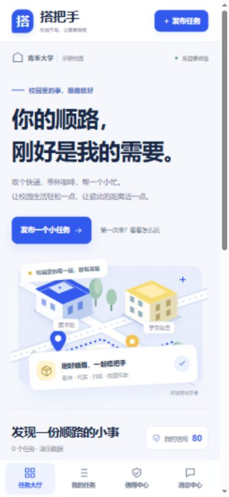

# 搭把手 · 校园跑腿互助平台

**[打开在线作品 ↗](https://campus-dabashou-20261015.mapletulip512.chatgpt.site/)　·　[产品案例](docs/case-study.md)　·　[简历表述](docs/resume.md)**

从北门取一个快递，到宿舍楼下交给同学：怎样让两个人都知道任务到了哪一步，又让这次帮助成为下次可以参考的信用记录？

这是一个由秋招限时附加题发展而来的 **Vibe Coding 产品作品**。首版优先交付公开链接，再在同一域名下迭代双角色流程、信用规则和移动端界面。技术栈为原生 HTML、CSS、JavaScript ES Modules 与浏览器本地存储。

| 手机宽度浏览器预览 | 一分钟体验 |
|---|---|
|  | **① 找顺路的任务**：搜索「快递」或按校区筛选。<br><br>**② 体验接单人**：打开任务，确认接单并标记送达。<br><br>**③ 切换发布者视角**：点击「模拟发布者确认」，再提交五星评价。<br><br>**④ 查看结果**：在「信用中心」核对完成 **+3**、好评 **+2** 两笔记录。初次体验时，信用会从 **80** 变为 **85**。 |

> 如果示例已超时，点击大厅的「刷新示例时限」。这不会重置自己发布的任务。

### 三个关键取舍

| 用户问题 | 产品决定 | 怎样验证 |
|---|---|---|
| 群消息刷得快，很难找到顺路的一单 | 将地点和时限放进任务卡，支持校区、分类和关键词筛选 | 按「图书馆」搜索，比较目的地和剩余时间 |
| 接单人说「送到了」，是否就算完成？ | **送达与确认分开**。接单人负责标记送达，发布者负责确认 | 送达后显示「待确认」；确认后才记履约分 |
| 信用分是否只是装饰？ | 每笔加分关联任务，完成和好评各记一次，总分封顶 100 | 查看信用明细；[回归测试](test-model.mjs)覆盖重复操作与角色错配 |

### 实现边界与复现

这是**免登录、本地数据的交互原型**。模拟按钮让一个访客走完双方流程；不同访客之间不共享订单，也不发生真实付款。

```sh
# 在仓库根目录运行，无需安装 npm 依赖
python -m http.server 8000 --directory dist
# 打开 http://localhost:8000
```

```sh
# Node.js 22：业务规则、页面结构、示例刷新
node test-model.mjs
node test-design.mjs
node test-demo.mjs
```

**代码导览：** [任务与信用规则](dist/model.mjs) · [视图与交互](dist/app.mjs) · [响应式样式](dist/style.css) · [原创校园路线插画](dist/campus-scene.svg)


